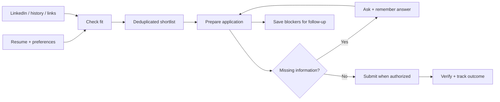

<div align="center">

# 🧭 Job Application Assistant

### A thoughtful job search, from first link to confirmed application.

**Discover relevant roles · Apply with accurate details · Remember your answers**

[Get started](#-get-started) · [Ways to use it](#-choose-your-starting-point) · [How it works](#-the-workflow) · [Privacy](#-your-data-stays-yours)

</div>

---

Turn a resume and a collection of job links into a clear, resumable application queue. This Codex skill can also search your signed-in LinkedIn, identify relevant openings, and help you apply—asking for missing details as they come up.

> **A skill, not a background service.** It guides an agent with browser or connector access. It does not run unattended, bypass site restrictions, or replace your judgment on applications and disclosures.

## ✨ What it handles

| Capability | What you get |
| :--- | :--- |
| **Resume-based matching** | Roles checked against your actual skills, projects, domain and experience. |
| **LinkedIn discovery** | Relevant openings from Jobs search, hiring posts and referenced original posts. |
| **History & synced tabs** | A queue built from the browser or device list you choose, with honest coverage tracking. |
| **Application help** | Accurate forms, resume attachments and tailored answers within your authorization. |
| **Answers that carry forward** | Confirmed facts saved privately, with their source and scope. |
| **Recruiter emails** | Short, specific messages, with unsent drafts when you want to review first. |
| **Clear outcomes** | Confirmed submissions separated from drafts, blockers and manual follow-ups. |

## 🚀 Get started

You need Codex, your resume, and supported browser/computer tools or relevant service connectors. For signed-in LinkedIn or email, connect the browser profile you actually use. Browser tooling and site permissions depend on your environment.

**Install from this repository** into your personal skill directory:

```bash
git clone https://github.com/prakhar083/job-application-assistant.git \
  ~/.codex/skills/job-application-assistant
```

The repository is private, so cloning requires an account with access. If you already installed the skill, update the existing copy instead of cloning over it. If you use a custom `CODEX_HOME`, use its `skills` directory.

**Or use the ZIP:** extract its `job-application-assistant` folder into `~/.codex/skills/`. Open a new Codex chat so the skill can be discovered, then invoke it by name:

```text
Use $job-application-assistant with my resume at [path].
Find backend roles on my signed-in LinkedIn in Chrome.
Shortlist suitable openings in Bengaluru and apply to strong matches.
Ask me for missing facts and remember my confirmed answers.
```

## 🔎 Choose your starting point

<details open>
<summary><strong>1 · Discover jobs on LinkedIn</strong></summary>

```text
Use $job-application-assistant to find jobs matching my resume.
Use my signed-in LinkedIn in Chrome. Start with 15 strong matches.
Consider my skills, domain, experience, location and sponsorship needs.
Show me the shortlist before applying.
```

For a search-and-apply workflow, explicitly ask the agent to apply to strong matches. A shortlist request stops at the shortlist.

</details>

<details>
<summary><strong>2 · Work through history or synced device tabs</strong></summary>

```text
Use $job-application-assistant to review job links under
Brave History → Your Devices → iPhone.
Open the application destinations in Chrome and apply to suitable roles.
Track anything I need to finish manually.
```

The agent records what it actually inspected and where to continue if the list is truncated.

</details>

<details>
<summary><strong>3 · Apply from a list of links</strong></summary>

```text
Use $job-application-assistant with these job links and my resume.
Avoid duplicates, ask for missing details, and verify each submission.
Leave assessments for me.
```

</details>

<details>
<summary><strong>4 · Draft recruiter outreach</strong></summary>

```text
Use $job-application-assistant to read this hiring post and its original post.
Prepare a short email to each published recruiter address with my resume.
Let me review both drafts before sending anything.
```

</details>

## 🗺️ The workflow



The queue stays resumable. While one application waits for an answer, another can move forward. An ambiguous submission is checked before any retry.

## 🔐 Your data stays yours

Reusable instructions live in this repository. Candidate details live separately on the user's computer:

```text
~/.local/share/job-application-assistant/
├── profile.json         # Confirmed facts, preferences and scoped answers
├── applications.json    # Application queue, when no existing tracker is used
└── handoff.md           # Progress, blockers and next actions
```

An existing tracker is reused where available. Passwords, OTPs, session tokens and cookies do not belong in these files. Personal resumes, contact details, salary information and application records are excluded from the skill export.

**Accuracy comes first:** no invented experience, guessed disclosures or assumed work authorization. Saved facts retain their source and scope; changing details are reconfirmed when needed. Tool-required approvals still apply to account setup, agreements and other consequential steps.

## 📋 Know what happened

| Outcome | Meaning |
| :--- | :--- |
| **Submitted** | A success screen, receipt or explicit status confirms the application. |
| **Draft ready** | Prepared for review; not sent or submitted. |
| **Awaiting you** | A specific answer, review or action is needed. |
| **Blocked** | A documented technical or access issue needs follow-up. |
| **Unconfirmed** | Submission was attempted, but success is not established. |
| **Skipped / closed** | Duplicate, poor fit, user instruction, or an unavailable opening. |

Every unfinished application should have a direct link, a reason and a next action.

## 📁 Inside the skill

```text
job-application-assistant/
├── SKILL.md
├── README.md
├── agents/openai.yaml
├── assets/
│   ├── profile-template.json
│   └── applications-template.json
└── references/
    ├── discovery.md
    └── state-and-memory.md
```

Start with [SKILL.md](SKILL.md) for the agent instructions. The [discovery guide](references/discovery.md) explains source collection and fit decisions; [state and memory](references/state-and-memory.md) defines private answers, status tracking and continuity.

---

<div align="center">

**Fewer repeated forms. Clearer follow-ups. A search you can pick up again.**

</div>
